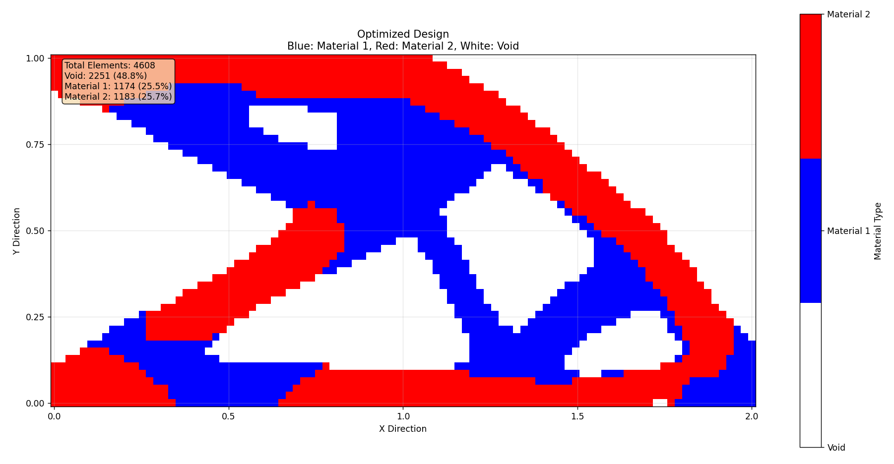

# Interface-Stress-Constraint-Topology-Optimization
This project covers the application of an Interface Stress Constraint in a multi-material topology optimization setting. Although the interface strength varies with the method of fabrication, the paper presents an indiscriminate method for handling angle dependent interface stresses.

What this folder contains
-------------------------

This package contains the documentation and environments for producing the 
computations and visualization for the (angle dependent) interface stress constraint in
a multi-material (2 materials) topology optimization setting where limits are set on tensile stresses within a material interface. 
The test setting remains constant:
96 x 48 elements and forces acting on the 7 right-most nodes on the bottom of the 
component. The weaker material (material 1) has a Young's modulus of 1 MPa and the stronger material
(material 2) has a Young's modulus of 2 MPa.

  - **README.md**          - General overview of the project
  - **InterfaceStressConstraint.pdf**          - Report on the findings
  - **Python codes**  - codes for producing the plots in the report
  
Key Findings
------------

While the compliance converged to similar values for both the angle-independent and the angle-dependent settings,
the final designs show clear differences in the placement of the material interface. The blue space is the weaker material (1 MPa)
and the red material is the stronger one (2 MPa). 

Python codes
------------
  - **Helmholtz2materialsISC17Forces.py**        - Angle independent version
  - **Helmholtz2materialsAngleForces.py**       - Angle dependent version
  - **Helmholtz2materialsISC17vsAngle.py**     - Produces the compliance comparison plot

What the analysis does
----------------------

1. Adds an Interface Stress Constraint (ISC) to a multi-material topology
  optimization setting.
2. ISC split up in two version: constant stress limits within an interface and
   an angle dependent version.
3. Compares the compliance optimization trajectory for both cases and compares them.
4. Visualizes final results in 2D and 3D plots and provides clear plots on the interfaces.
   

Generated python plots
-----------------
  baseline_stats.png                 RMS / kurtosis / crest @ 0.007" 0 HP
  time_signals_0_2000.png            Time signals, samples 0-2000
  time_signals_10000_10500.png       Time signals, samples 10000-10500
  time_signals_50000_50500.png       Time signals, samples 50000-50500
  fft_magnitude_0_2000.png           FFT magnitude, samples 0-2000
  fft_magnitude_10000_10500.png      FFT magnitude, samples 10000-10500
  fft_magnitude_50000_50500.png      FFT magnitude, samples 50000-50500
  cm_unknown_load.png                Confusion matrix (unknown 2 HP)
  cm_unknown_severity_fft.png        Confusion matrix (0.021", FFT+time)
  cm_unknown_severity_envelope.png   Confusion matrix (0.021", envelope)
  accuracy_comparison.png            Head-to-head test accuracy bar chart
                                   (portfolio summary figure for the report)

How to regenerate the plots
---------------------------

-  BearingFault.py
-  BearingFault021unknown.py
-  BearingFaultDifferentApproach.py

Requirements
------------
Python 3.x with: numpy, matplotlib, scipy, scikit-learn, CWRU NORMAL BASELINE DATA and CWRU 12k DRIVE END BEARING FAULT DATA

Key result snapshot (from last run)
-----------------------------------
  Datasets loaded: 61 (Normal baseline at 0 HP only — no Normal in tests)

  Unknown load (train 0/1/3 HP → test 2 HP, FFT+time RF):
    Test accuracy: 95.37%
    Ball/OR nearly perfect; main errors IR → OR

  Unknown severity (train 0.007/0.014/0.028" → test 0.021", FFT+time RF):
    Test accuracy: 27.93%
    Severe IR/OR confusion; broadband spectra do not transfer by size

  Unknown severity (same split, envelope BPFO/BPFI/BSF RF):
    Test accuracy: 70.42%
    Physics-informed envelope features recover most of the gap

  Takeaway: load shift is easy for FFT features; unknown defect size is
  hard; characteristic-frequency envelope features improve OOD severity
  generalization with far fewer dimensions (15 vs 255).
